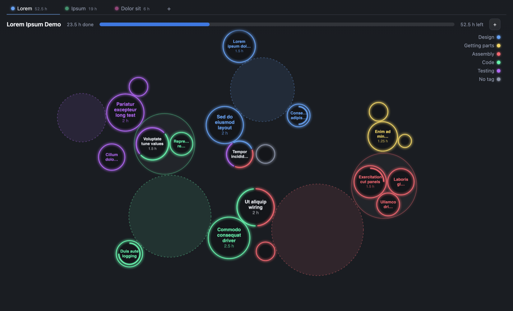

# skills

Two Claude skills.

## create-presentation

Simple reveal.js presentations in one fixed, minimal style. You lead, and Claude builds what you ask for.

**How it works**

1. Claude builds the skeleton and serves it on localhost.
2. You describe slides one at a time, and Claude builds them, with a screenshot of each.

Claude never proposes an outline or what to build next. It suggests an improvement only when the effect is big, and it never writes content or speaker notes of its own.

**Every deck has**
- Black slides, white text and one accent colour, suggested by Claude if you don't pick one.
- An opener that starts on a black slide, with the first line fragmenting in. There's no title slide.
- Slide titles at the same height on every slide.
- A small grey triangle in the top right corner, lit when the next press will change slide.
- Maths, always loaded (KaTeX).
- Images that each link to their original source.
- A Sources slide at the end, with an Images slide below it.

**Optional:** a callback to the opener (Claude suggests it once), an Inspiration slide, and one file per section once the deck grows.

## to-do-bubbles

Bubbles is a to-do tracker for projects you work on alone, in short sessions, with no deadlines on purpose.

- Each to-do is a glowing bubble sized by its estimated hours, and bubbles of the same tag cluster together.
- Hold a bubble to pop it, and it asks how long the to-do really took. The done drawer then compares your estimates with the real times.
- Sheets (tabs) hold several projects in one tracker. Drag a tab to reorder; sheets are archived, never deleted.

**Where a tracker runs**
- **Localhost:** your data stays in a JSON file on your computer. `serve.py` (Python standard library only) saves every change safely and keeps backups.
- **claude.ai artifact:** share it with others. Contributors can edit, viewers see a read-only version, and simultaneous edits merge instead of overwriting each other.

Open `to-do-bubbles/assets/demo.html` for a demo with sample data.

## Install

- **Claude Code:** copy a skill folder into `~/.claude/skills/` (all your projects) or `<project>/.claude/skills/` (one project).
- **claude.ai:** zip a skill folder and upload it under Settings → Capabilities → Skills.

## Licence

[GPL-3.0](LICENSE). You can use, change and share these skills, including commercially, as long as anything you distribute that is built on them is also released under the GPL with its source.

**Your presentations are yours.** A [presentation exception](LICENSE-EXCEPTION) lets you publish decks made with create-presentation under any terms you like, even though they contain the skill's template. The exception covers the decks only: the skill itself stays GPL.
